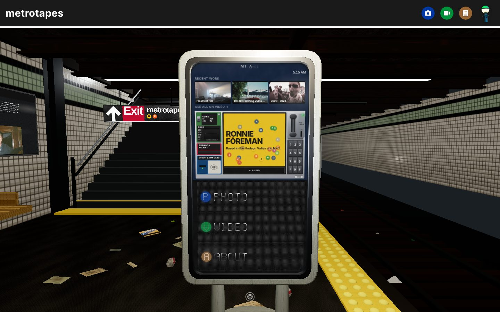
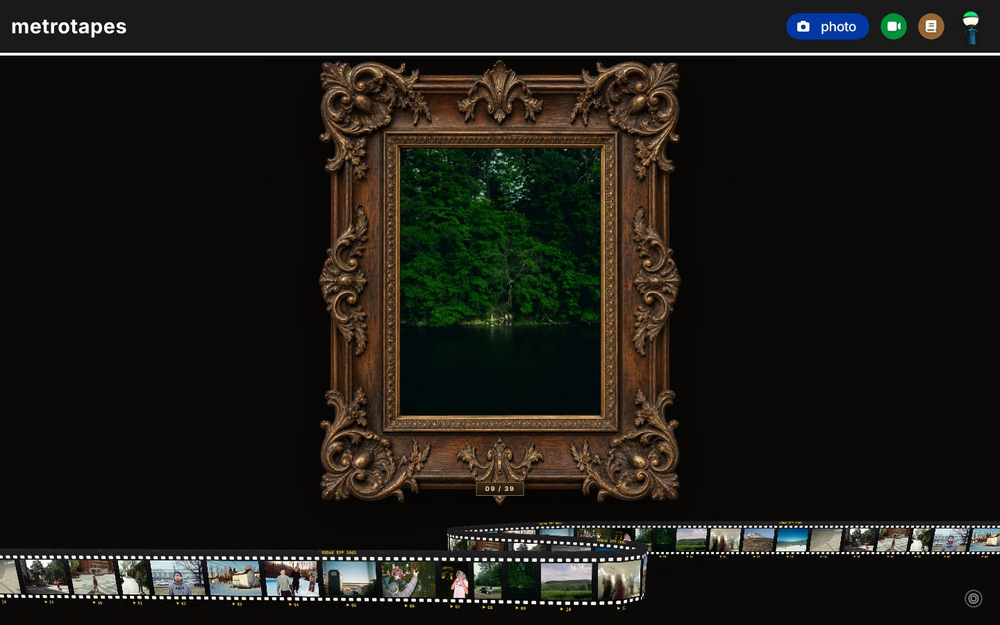
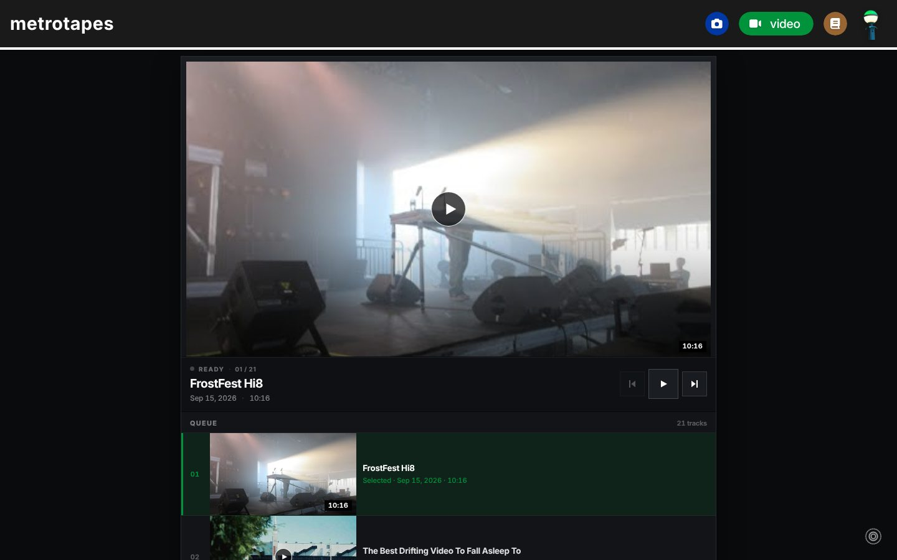
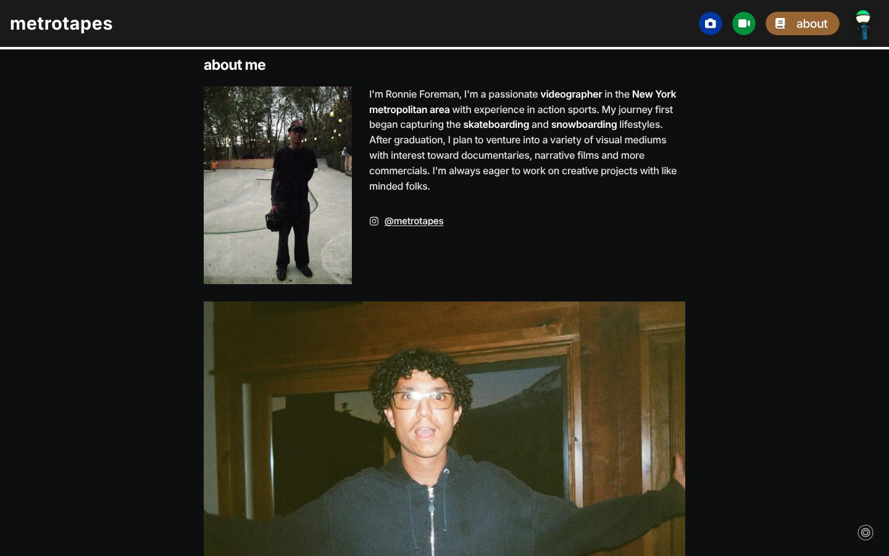
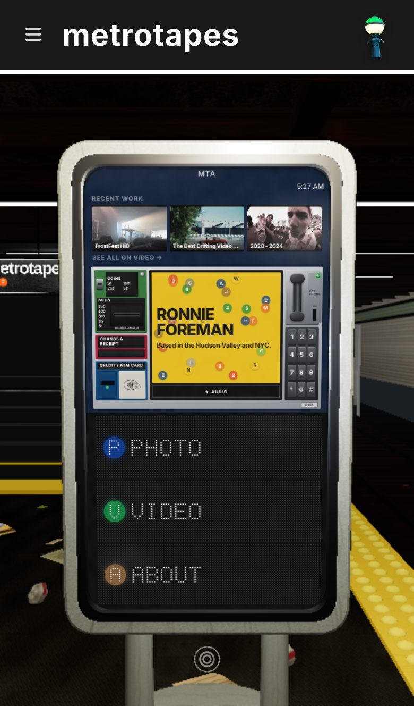
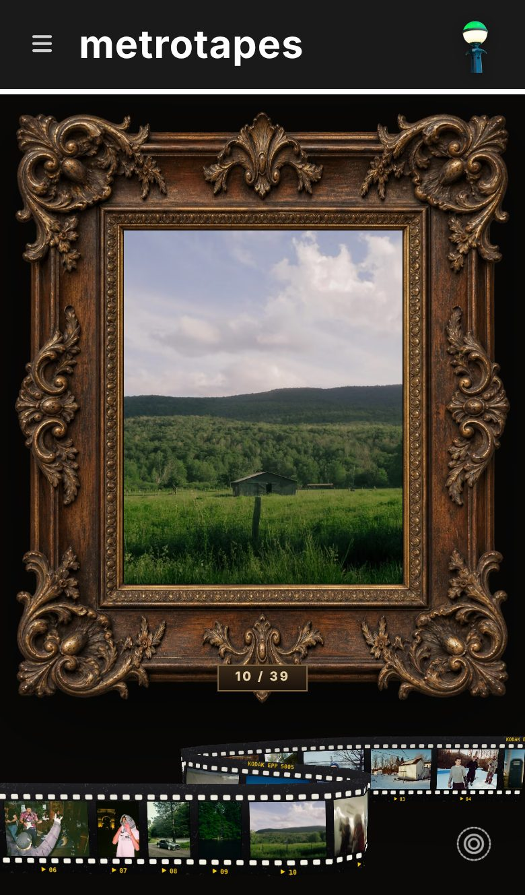

# Metrotapes

The portfolio site for Metrotapes, built as an interactive subway station. The station is the navigation: the photo, video and about pages are camera shots inside a 3D scene rather than separate page layouts.

Live at [metrotapes.com](https://metrotapes.com).



| Photo wall | Video wall | About wall |
|---|---|---|
|  |  |  |

On a phone the camera frames the kiosk portrait, and the walls fill the screen:

| Kiosk | Photo wall |
|---|---|
|  |  |

## How it works

- A boot screen leads into a kiosk in the station. Routes are `/`, `/photo`, `/video`, and `/about`.
- The scene is built with React Three Fiber and Three.js, with post-processing and a few graphics quality tiers.
- Photos and about text come from Sanity through same-origin endpoints: `/api/photos` and `/api/about`. The public site does not call the Sanity API from the browser. Image files still load from `cdn.sanity.io`.
- Videos are read from a YouTube playlist through `/api/videos`, which falls back to the playlist's RSS feed when no API key is set. The playlist id is read from Sanity on the server.
- The Sanity Studio lives in `studio/` and is built into the deployed site under `/studio`. Studio keeps its own connection to Sanity.
- A longer walkthrough of routing, the station, and the API routes is in [docs/how-it-works.md](docs/how-it-works.md).

## How this was made

- **No 3D model files.** There is no Blender, `.glb` or `.obj` in the repo. The platform, pillars, stairs, train and kiosk are Three.js primitives assembled in code, and the tile, grime, concrete and steel textures are painted onto 2D canvases at load time (`src/station/textures.js`). The scene is small to download, and every dimension is a named constant in `src/station/space.js`.
- **The wall pages are real HTML in 3D space.** Photo, video and about are normal React pages positioned on the walls with CSS 3D (`src/station/css3d.js`), so they stay sharp and accessible. See [docs/station-map.md](docs/station-map.md) for which file builds which part of the station.
- **Built with AI coding agents.** The code was written with AI agents working from design direction, with a human deciding what the site is, how it looks and what goes on it. `AGENTS.md` is the onboarding file for them.
- **It degrades on purpose.** Quality tiers drop on weak GPUs and never go back up mid-session. If WebGL is missing or the context is lost, the same pages render flat.

## Stack

Vite, React 19, React Router, Three.js with React Three Fiber, styled-components, Sanity, deployed on Vercel.

## Running it locally

You need a current Node.js LTS.

```sh
npm install
npm run dev
```

The site runs on the Vite dev server, which also serves `/api/videos`, `/api/photos`, and `/api/about`. You do not need `vercel dev` for those routes. (`npx vercel dev` works too, if you want the Vercel runtime locally.) To edit content locally, run the studio in a second terminal:

```sh
npm install --prefix studio
npm run dev:studio
```

Optional environment variables (copy `.env.example` to `.env.local`):

- `YOUTUBE_API_KEY` for the YouTube Data API. Without it the video list uses the playlist RSS feed. Server-only.
- `SANITY_PROJECT_ID` and `SANITY_DATASET` to point the API at a different Sanity project. The defaults are the production ones (`l3itmzli` / `production`). The dataset is public, so no Sanity token is needed.
- `VITE_SANITY_PROJECT_ID` and `VITE_SANITY_DATASET` optionally override the public project id and dataset used to build image URLs in the browser. Same defaults.
- `SANITY_STUDIO_PROJECT_ID` and `SANITY_STUDIO_DATASET` optionally override those values for Studio. Same defaults.

Don't add `VITE_` secrets. Anything with that prefix can end up in the public JS bundle, and the build fails if a secret-looking env value (name containing TOKEN, KEY, SECRET or PASSWORD) shows up in it.

The content routes send `Cache-Control: s-maxage=60, stale-while-revalidate=86400` and `/api/videos` sends `s-maxage=3600, stale-while-revalidate=86400`, so the Vercel CDN answers most requests and refreshes in the background. A Sanity publish can take up to a minute to show up, and a playlist change up to an hour.

## Scripts

- `npm run dev` starts the site
- `npm run dev:studio` starts the Sanity Studio
- `npm run build` builds the site and the studio
- `npm run build:site` builds only the site
- `npm run lint` runs ESLint
